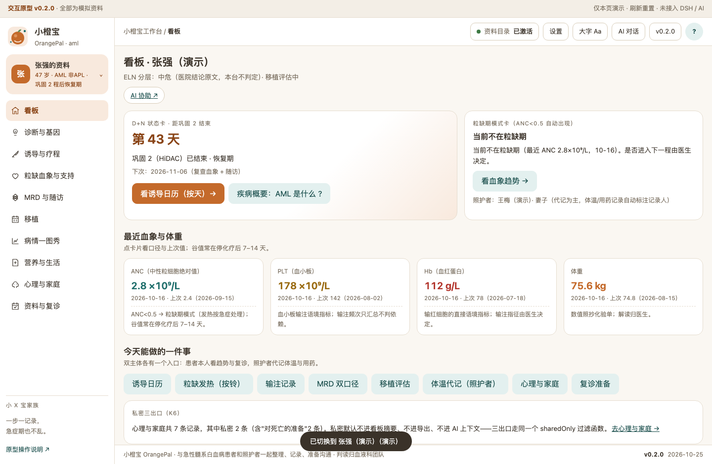
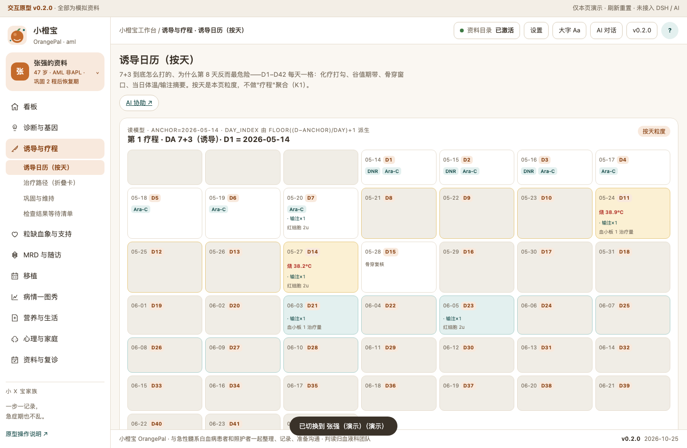
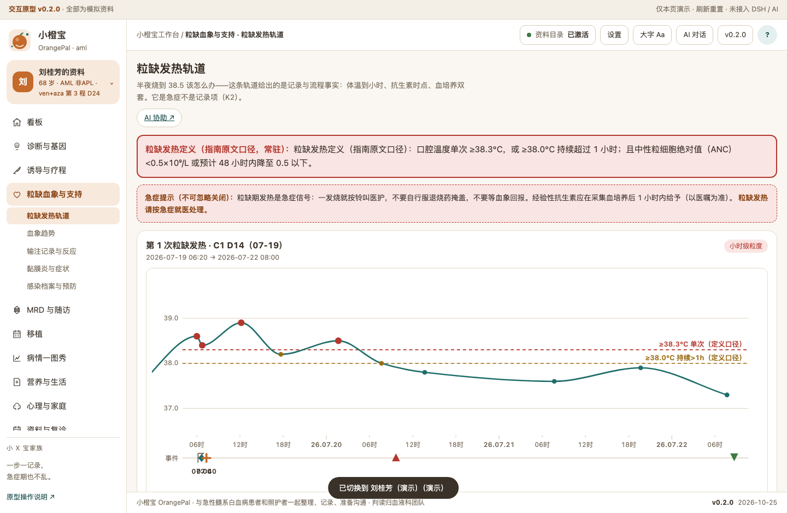
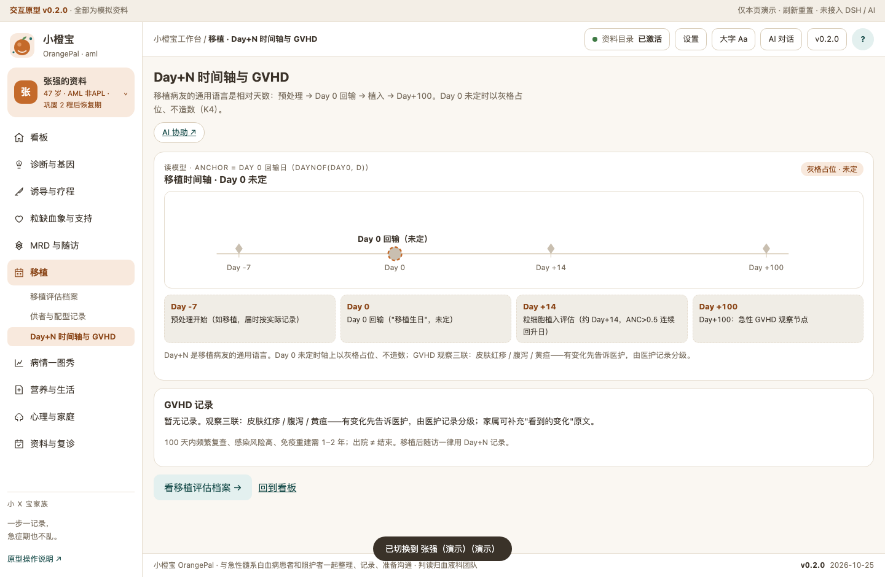
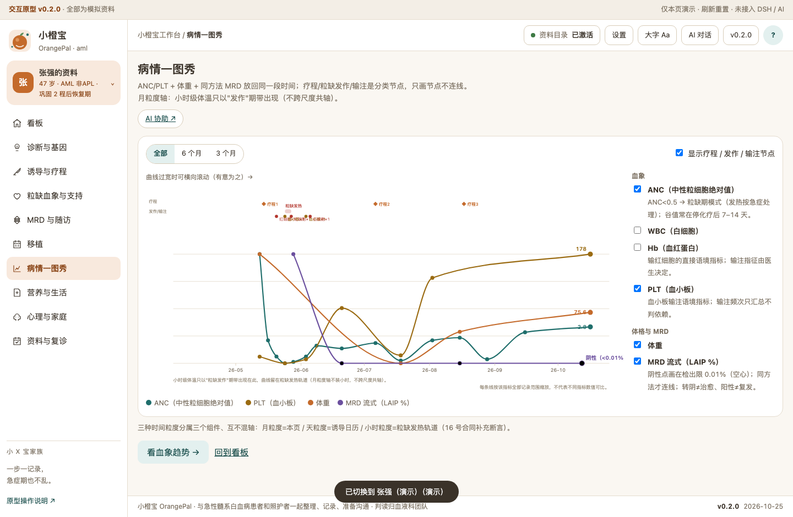
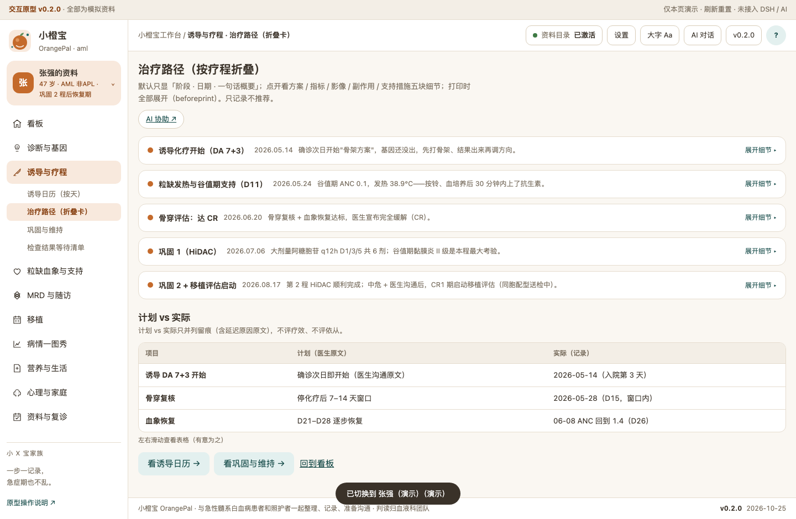
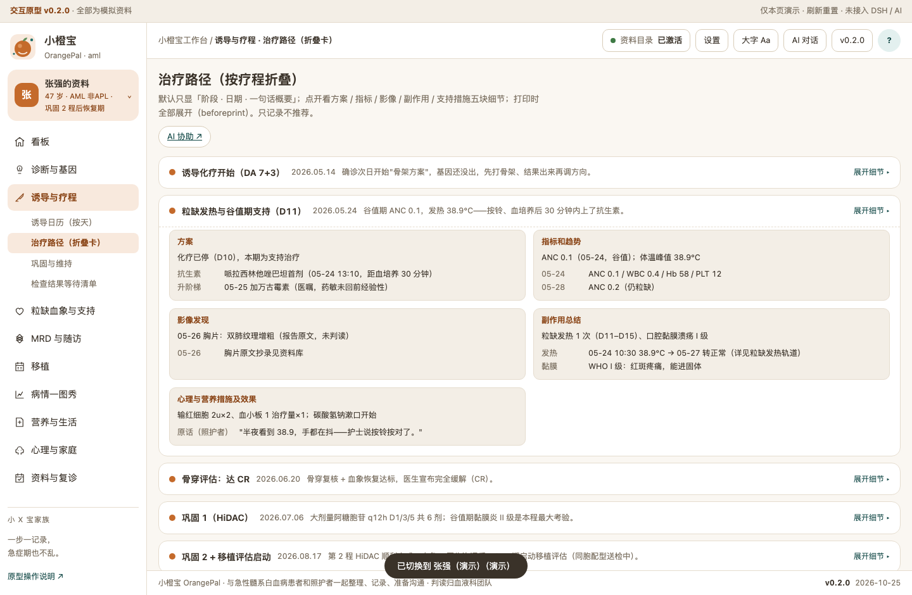
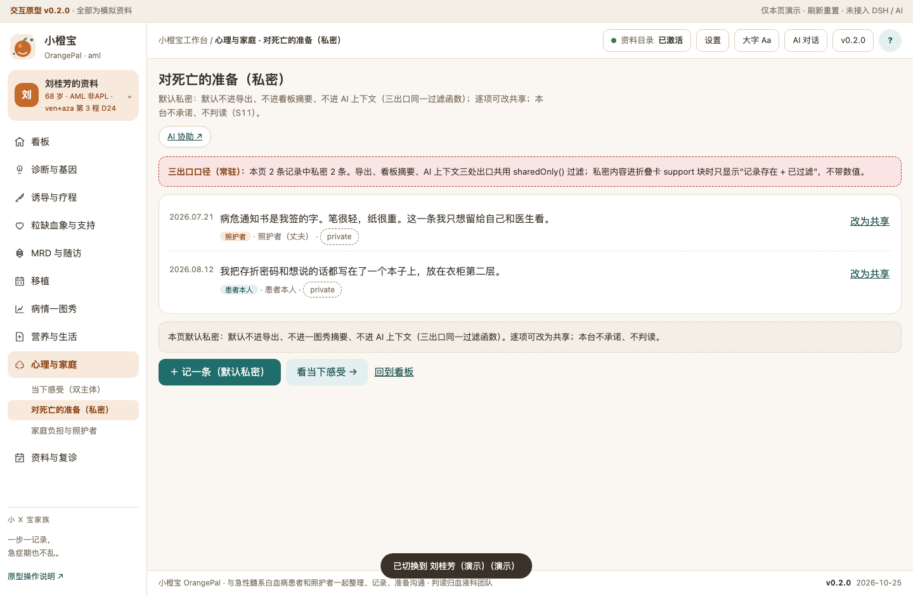

# 小橙宝 OrangePal · 急性髓系白血病（AML）工作台

一句话定位：与急性髓系白血病患者和照护者一起整理、记录、准备沟通——诱导日历按天、粒缺发热小时级轨道、MRD 双口径、移植评估、输注记录。
**不做声明：不诊断 / 不建议 / 不判复发 / 移植零推荐 / 输注不判依赖；判读归血液科团队。**

当前状态：M2 交互原型 v0.2.0（10 线 27 页签 + 三新组件），数据为合成演示（`demo/build-demo-data.mjs` 唯一源），未接入 DSH / AI。初始化与脚手架说明见 `docs/DESIGN-PROMPT.md` / `docs/BRIEF.md`；需求见 `docs/DEV-REQUIREMENTS-2026-10-26.md`（K1–K6）。

## 关键功能（实渲截图 · 演示数据）

**看板**——"现在到疗程第几天？今天注意什么？"：D+N 状态卡、粒缺期模式卡（ANC<0.5 自动出现）、最近血象、双主体入口与场景直达。



**诱导日历（按天）**（AML 首创 dayGrid）——"7+3 到底怎么打的？为什么第 8 天反而最危险？"：D1–D42 每天一格，化疗打勾、谷值期带、骨穿窗口、当日体温/输注摘要；无记录显示灰格（允许"仅知月份"）。



**粒缺发热轨道**（AML 首创 hourLane）——"半夜烧到 38.5 该怎么办？"：体温精确到小时、38.3/38.0 定义口径参考线、血培养双套与抗生素时点节点；定义原文常驻、急症提示不可忽略；照护者代记自动标注记录人（双源）。



**Day+N 相对天数轴**——移植病友的通用语言：Day 0 回输锚点（未定时灰格占位、不造数）、植入 Day+14、Day+100 GVHD 观察节点。



**病情一图秀**——"变化发生在哪一步？"：ANC/PLT + 体重 + 同方法 MRD 放回同一段时间；疗程/粒缺发作/输注是分类节点只画节点不连线；月粒度轴不装小时（不跨尺度共轴）。



**治疗路径折叠卡**——默认只显「阶段 · 日期 · 一句话概要」，点开五块细节（方案/指标/影像/副作用/支持）；打印时全部展开（beforeprint 实测，printToPDF 打印中 5 卡全开、打印后恢复）。




**私密三出口**（红线页）——"对死亡的准备"默认私密：默认不进导出、不进看板摘要、不进 AI 上下文（同一个 sharedOnly 过滤函数贯穿三出口）。



## 怎么用

- **原型（设计态）**：双击打开 `prototypes/v0.2/index.html` 即可（file:// 零依赖）；顶部「?」打开疾病概要（36 号）。
- **Desktop 装机（M6 后）**：本地 tgz 安装 / profile 内 `pnpm add @xyb-community/aml-workbench`；首次先新建会话。
- **AI 协助（34 号契约）**：页面「AI 协助 ↗」是 `aml:agent-draft` 协议链接——嵌入式（壳层 iframe）形态把预写提示词 + 已确认病情上下文**直接发送**到 AI 对话开启互动；AI 回复是**候选**，核对才采纳、拒收零副作用；独立打开原型时走演示面板、不假装发送。

## 数据与口径

- 本机优先；演示数据为合成（人物、数值与时间线不指向任何真实患者）。
- 试验条目取 2026 登记库样例（venetoclax / FLT3 / IDH），登记状态未核实——**线索不是推荐**。
- 粒缺发热定义、预防用药、WHO 分级均为指南/院方语境原文引用；本台只展示不判定。
- version：见 `VERSION` 与页面版本号（v0.2.0）。

## 开发

```bash
node demo/build-demo-data.mjs   # 演示数据唯一源 → prototypes/v0.2/demo-data.js + public 同步件
npm run probe:resp              # 窄宽 8 档 × 13 页（含 dayGrid/hourLane）
npm run probe:m2                # 37 路由 × 2 档案截图 + 三新组件 + computed fill=none 断言
npm run check:hvt               # HVT X1–X4（覆盖/走通/编辑入口/候选闭环）
npm run check:wording           # 禁词 0 + 必现句 12（红线文案必须上屏）
npm run check                   # 装包合同链（原有）
```

文档索引：`docs/DEV-REQUIREMENTS-2026-10-26.md`（K1–K6）· `docs/INTERACTION-DESIGN.md`（v1）· `docs/RESPONSIVE-RULES.md`（30 号）· `docs/33-README-SCREENSHOTS.md` · `docs/34-AGENT-DRAFT-SEND.md` · `docs/32-TREATMENT-PATHWAY-FOLDOUT.md` · `research-notes/family-landscape.md` §6（页面树唯一权威）。

初始化来源记录见 `.dsh-wb-starter.json`；Logo 来源见 `assets/README.md`；许可证 UNLICENSED（模板默认）。
