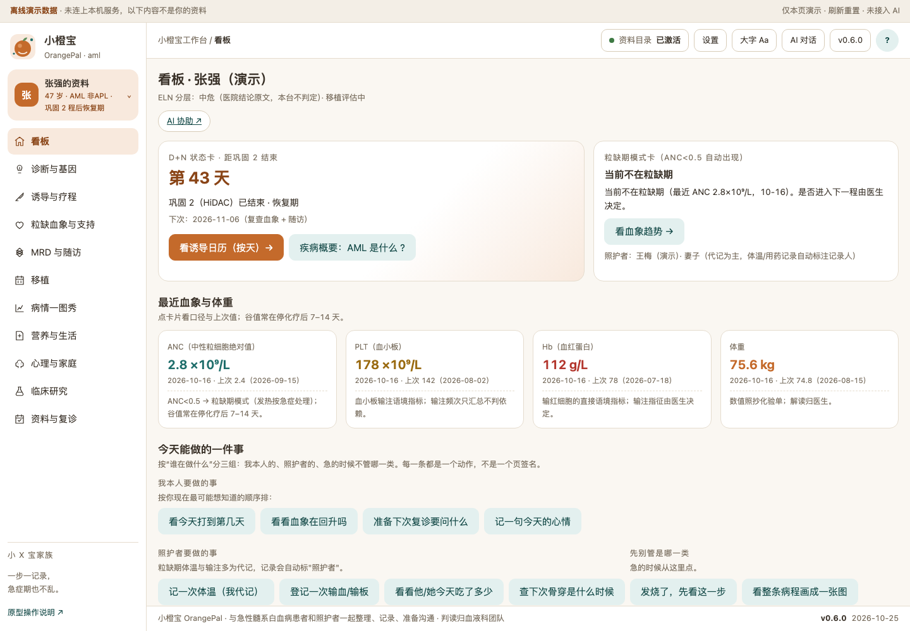
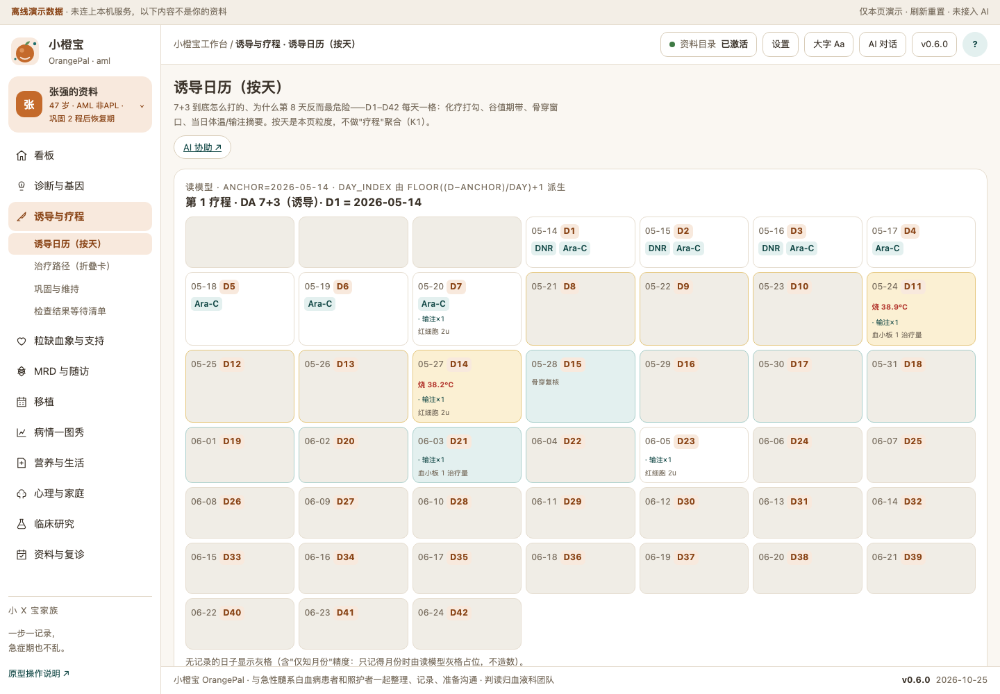
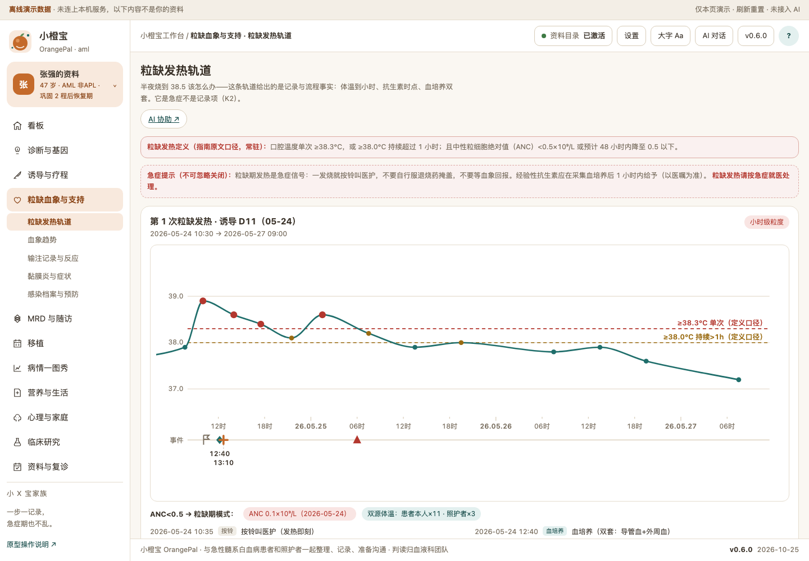
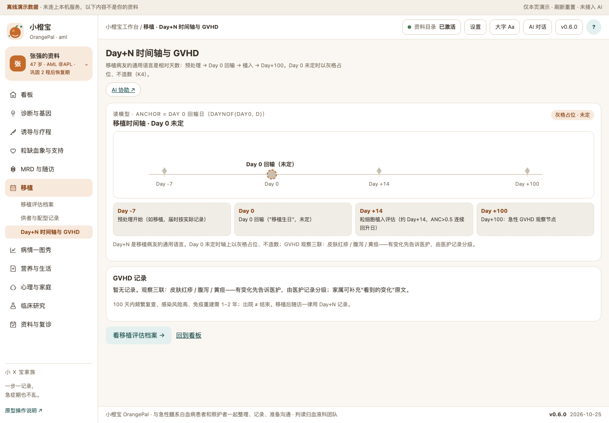
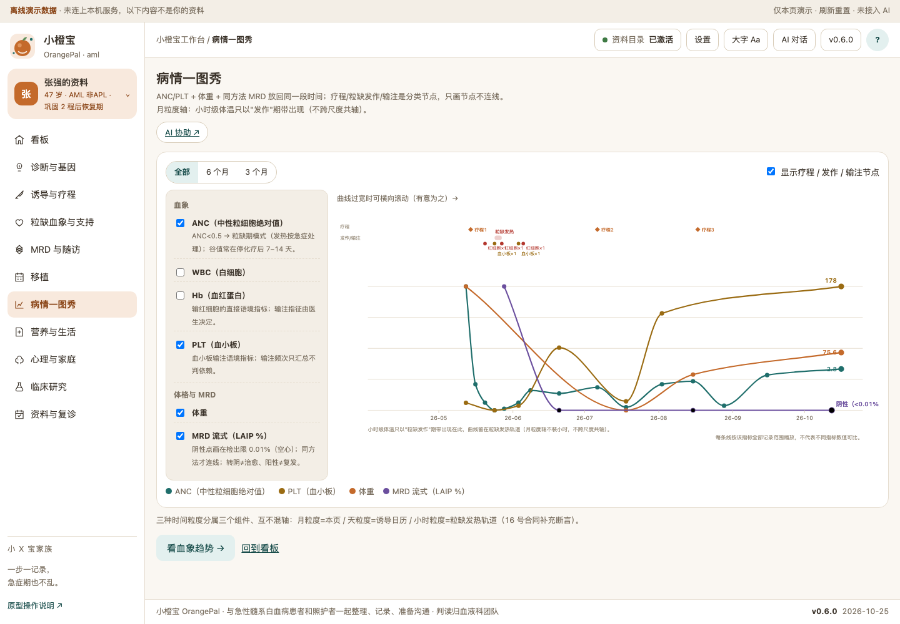
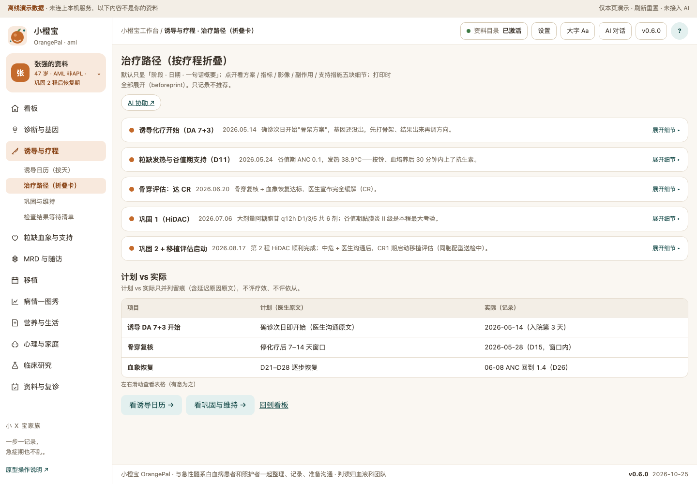
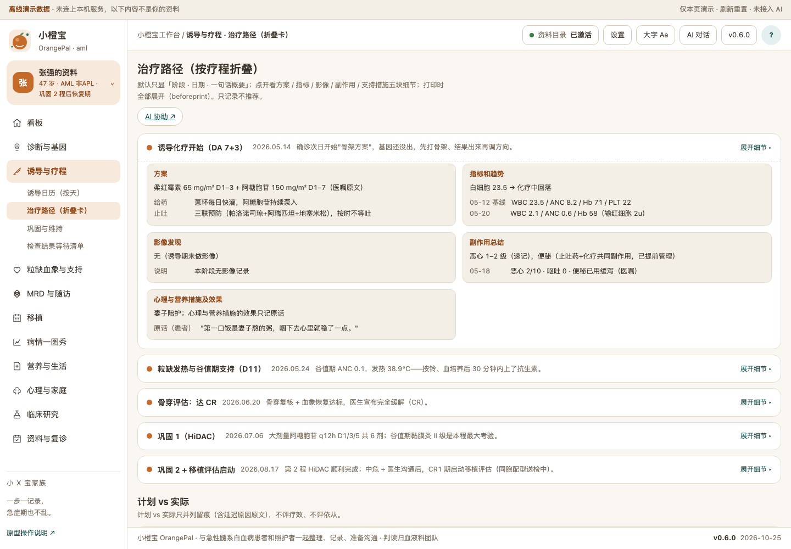
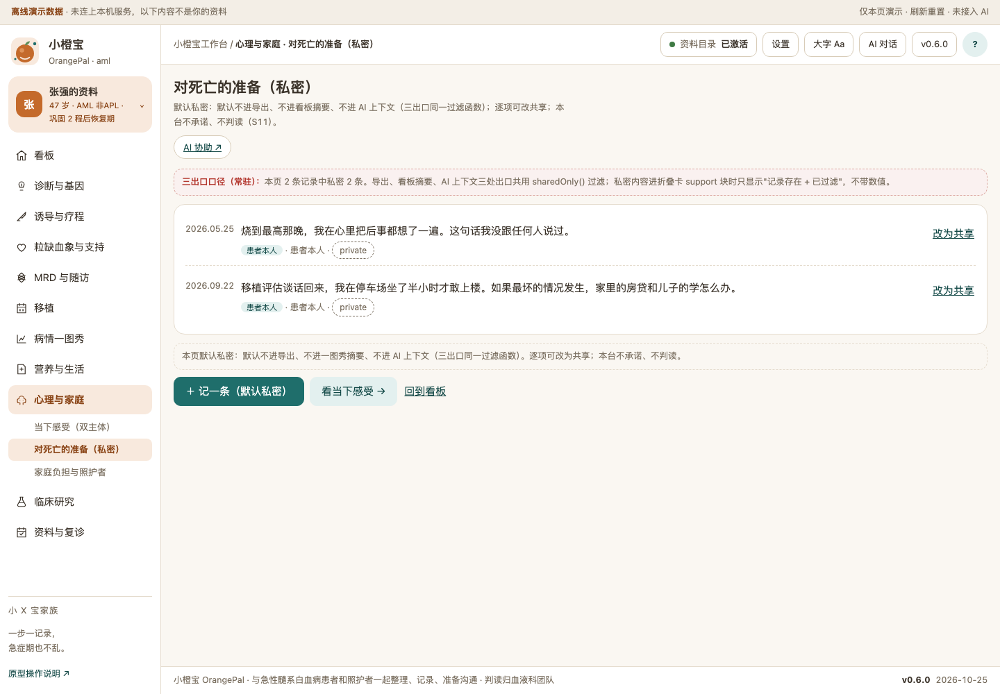
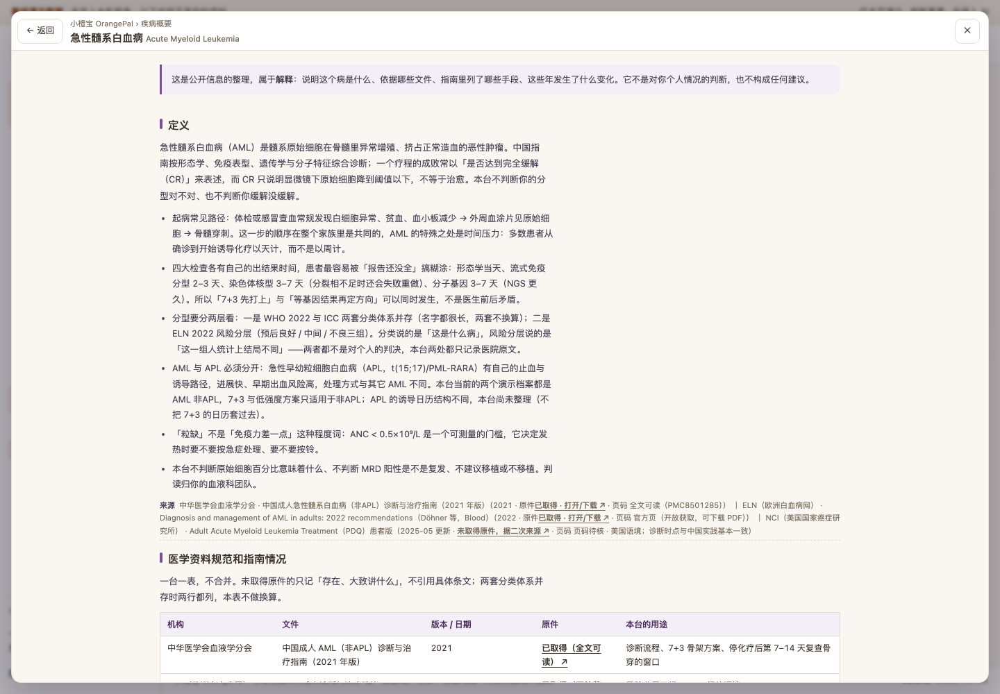

# 小橙宝 OrangePal · 急性髓系白血病（AML）工作台

一句话定位：与急性髓系白血病患者和照护者一起整理、记录、准备沟通——诱导日历按天、粒缺发热小时级轨道、MRD 双口径、移植评估、输注记录。
**不做声明：不诊断 / 不建议 / 不判复发 / 移植零推荐 / 输注不判依赖；判读归血液科团队。**

当前状态：开发版 v0.6.0（10 线 27 页签 + 三新组件 + 本机 sqlite 事实层 + MinerU 六部件 + 宿主接线 + 零治疗三步初始化），数据为合成演示（`demo/build-demo-data.mjs` 唯一源），AI 走宿主原生会话（34 号一键发送）。**未装机验证**：本版本只做到 dev-server 实测（`npm run probe:m5`），装进 DSH Desktop 的确认另计。初始化与脚手架说明见 `docs/DESIGN-PROMPT.md` / `docs/BRIEF.md`；需求见 `docs/DEV-REQUIREMENTS-2026-10-26.md`（K1–K6）。

## 疾病概要

> 顶栏「?」打开完整版（含逐段来源与页码）。这一段只做**解释**：这个病是什么、依据哪些文件、指南列过哪些手段、这些年发生了什么变化。它不是对你个人情况的判断，也不构成任何建议。

### 定义

急性髓系白血病（AML）是髓系原始细胞在骨髓里异常增殖、挤占正常造血的恶性肿瘤。一个疗程的成败常以「是否达到完全缓解（CR）」表述，而 CR 只说明显微镜下原始细胞降到阈值以下，不等于治愈。**AML 与 APL 必须分开**：急性早幼粒细胞白血病（APL，t(15;17)/PML-RARA）有自己的止血与诱导路径，早期出血风险高。本台当前两个演示档案都是 AML 非APL，7+3 与低强度方案只适用于非APL；APL 线尚未建立，不把 7+3 日历套过去。

四大检查各有自己的出结果时间，患者最容易被「报告还没全」搞糊涂：形态学当天、流式免疫分型 2–3 天、染色体核型 3–7 天（分裂相不足还会失败重做）、分子基因 3–7 天（NGS 更久）。所以「先打上 7+3」与「等基因结果再定方向」可以同时发生，不是医生前后矛盾。分型分两层看：WHO 2022 与 ICC 两套分类体系并存且不换算；ELN 2022 风险分层（预后良好 / 中间 / 不良三组）。前者说「这是什么病」，后者说「这一组人统计上结局不同」——都不是对个人的判决。「粒缺」不是「免疫力差一点」这种程度词：ANC < 0.5×10⁹/L 是可测量的门槛，它决定发热时要不要按急症处理。本台不判断原始细胞百分比意味着什么、不判断 MRD 阳性是不是复发、不建议移植或不移植，判读归你的血液科团队。

**来源**：中华医学会血液学分会 · 中国成人 AML（非APL）诊断与治疗指南（2021 年版）· 2021 · 原件已取得（全文可读）· 页码见指原文 ｜ ELN（欧洲白血病网）· Diagnosis and management of AML in adults: 2022 recommendations（Döhner 等，Blood）· 2022 · 原件已取得（官方 PDF）· 页码待核 ｜ NCI · Adult AML Treatment（PDQ）患者版 · 2025-05 更新 · 未取得原件，据二次来源 · 页码待核

### 医学资料规范和指南情况

一台一表，不合并。未取得原件的只记「存在、大致讲什么」，不引用具体条文；两套分类体系并存时两行都列，本表不做换算。

| 机构 | 文件 | 版本 / 日期 | 原件 | 本台的用途 |
|---|---|---|---|---|
| 中华医学会血液学分会 | 中国成人 AML（非APL）诊断与治疗指南（2021 年版） | 2021 | 已取得（全文可读，PMC8501285） | 诊断流程、7+3 骨架方案、停化疗后第 7–14 天复查骨穿的窗口 |
| ELN | AML 成人诊断与治疗建议（Blood，Döhner 等） | 2022 | 已取得（官方 PDF） | 风险分层三组、MRD 阈值语境 |
| 中华医学会等 | 中国中性粒细胞缺乏伴发热患者抗菌药物临床应用指南（2020 年版） | 2020-12 | 已取得（英文版 PMC） | 粒缺发热定义：口腔 ≥38.3℃ 单次，或 ≥38.0℃ 持续 >1 小时，且 ANC<0.5 或预计 48 小时内降至 0.5 以下 |
| 同上（新版） | 含 CRO 耐药菌更新 | 2026 | 未取得原件，据二次来源（iidf.com.cn） | 仅记「存在新版、含耐药菌更新」，不引条文；上线前须按新版校对 |
| NCCN | NCCN Guidelines: AML | 3.2026（2025-11-24 发布，取代 2.2026） | 未取得（正文需注册下载，仅元信息） | 仅用于范围声明「参照 NCCN AML 3.2026」，不引条文 |
| CSCO | CSCO 恶性血液病诊疗指南 2025 | 2025-04（发布报道） | 未取得原件，据会议报道 | 仅记录「2024/2025 有更新」这一事实 |
| ELN | AML MRD 更新 | 2021 | 已取得（官方 PDF） | 0.01% / 0.1% 阈值语境的原始出处之一 |
| 中国专家共识 | 造血干细胞移植临床实践整体评估（2025 年版） | 2025 | 未取得原件，据平台转介 | 仅列「有这份共识」，移植适应语境不引条文 |

**来源**：见上表逐行；未取得原件的行不引条文、不写页码

### 目前治疗全景概要

只列指南与说明书里出现过的手段，按治疗阶段与线序分组，不排序、不比优劣。

**诱导**：标准骨架「7+3」＝阿糖胞苷连输 7 天 + 蒽环类 3 天；中国指南同时允许按年龄、体能、合并症调整强度，所以「标准强度」与「低强度」两条路在同一份指南里并存。低强度常见为去甲基化药物（阿扎胞苷 / 地西他滨）联合维奈克拉（中国首次上市 2020 年 12 月，据国家医保局 2022 年申报材料）。APL 不走 7+3，以 ATRA 联合砷剂为核心，早期重点在止血管理。诱导后约停化疗第 7–14 天复查骨穿（中国指南明确写此窗口）。

**巩固**：常见为 HiDAC 多个疗程，疗程数与间隔取决于风险组与耐受情况；巩固期同样会出现粒缺与血象低谷。

**移植评估**：指南里是「以风险换治愈机会」的选项——高危/ELN 不良组常在 CR1 即评估；中危若 MRD 持续阳性或复发后再缓解（CR2）也是主要评估时点。评估含供者 HLA 分型、脏器功能、合并症与心理社会评估。

**复发后**：再诱导化疗（含氟达拉滨的联合方案语境，如 FLAG 类）、按基因选择靶向药、临床试验、再缓解后移植。按基因选择举例：FLT3→吉瑞替尼（NMPA 2021 获批）、IDH1→艾伏尼布（NMPA 2022-01 获批）、BCL-2→维奈克拉联合方案。具体适应症须逐一核对说明书。临床试验在这一阶段是正规选项之一，不是「没办法了才去试」。

**贯穿全程的支持治疗**：粒缺伴发热按急症处理（中国 2020 指南口径：1 小时内启动经验性抗菌治疗）；输血支持、口腔黏膜炎防治、止吐、真菌与病毒预防、营养与心理支持各有自己的记录点，本台分线记录。

> 以上是文献与指南里列出的手段，按病期与线序排列，不代表任何一项适合你。选哪一个，这一句需要问你的医生。

**来源**：中华医学会血液学分会 · 中国成人 AML（非APL）指南（2021 年版）· 2021 · 原件已取得 ｜ ELN · AML 成人诊断与治疗建议 · 2022 · 原件已取得 ｜ 国家医疗保障局 · 维奈克拉片医保申报材料 · 2022 申报 · 原件已取得（申报材料非批件原文，批件号未核实） ｜ NCCN · NCCN AML 3.2026 · 2025-11-24 · 未取得原件（仅元信息，不引条文）

### 发展趋势

只写已经发生的事实，每条带日期或版本号。

- **指南版本**：NCCN AML 现行版为 3.2026，2025-11-24 发布、取代 2.2026。CSCO 恶性血液病诊疗指南 2025 已发布（会议报道，2025-04），正文为实体书，未取得。
- **指南更新**：ELN 2022 建议之后是否有 2024–2026 版更新，本项目未核实——按「ELN 2022 为最新已取得版本」处理，不假设没有新版。
- **监管批件（说明书级）**：吉瑞替尼 NMPA 2021 年获批（FLT3 突变复发/难治 AML）；艾伏尼布 NMPA 2022 年 1 月获批（IDH1 易感突变复发/难治成人 AML）；维奈克拉中国首次上市 2020 年 12 月（据国家医保局 2022 年申报材料）。批准日期与批件号未逐条核实。
- **支持治疗规范**：中性粒细胞缺乏伴发热的中国指南存在 2020 版与 2026 新版两个版本；2026 版含 CRO 耐药菌更新，本项目未取得全文。
- **在研登记**：2026-10-26 快照，去重后 241 条（中国药物临床试验登记与信息公示平台 188 条、CTV 53 条），登记状态一律「登记状态，未核实」；ChiCTR 与 ICTRP 本次采集未成功，属采集缺口而非「没有登记」。
- **分类体系**：本台按 WHO 2022 与 ICC 两套体系并记、不换算；项目资料未见更新的分类版本记载。

**来源**：NCCN · NCCN Guidelines: AML · 3.2026（2025-11-24）· 未取得原件（仅元信息）｜ CSCO · CSCO 恶性血液病诊疗指南 2025（发布报道）· 2025-04 · 未取得原件，据会议报道 ｜ 本项目登记快照 · research/aml-cancer/manifest.json · 2026-10-26 · 原件已取得（ChiCTR/ICTRP 采集失败如实记录）｜ 国家医疗保障局 · 维奈克拉片医保申报材料 · 2022 申报 · 原件已取得（批件号未核实）

## 关键功能（实渲截图 · 演示数据）

**看板**——"现在到疗程第几天？今天注意什么？"：D+N 状态卡、粒缺期模式卡（ANC<0.5 自动出现）、最近血象、双主体入口与场景直达。



**诱导日历（按天）**（AML 首创 dayGrid）——"7+3 到底怎么打的？为什么第 8 天反而最危险？"：D1–D42 每天一格，化疗打勾、谷值期带、骨穿窗口、当日体温/输注摘要；无记录显示灰格（允许"仅知月份"）。



**粒缺发热轨道**（AML 首创 hourLane）——"半夜烧到 38.5 该怎么办？"：体温精确到小时、38.3/38.0 定义口径参考线、血培养双套与抗生素时点节点；定义原文常驻、急症提示不可忽略；照护者代记自动标注记录人（双源）。



**Day+N 相对天数轴**——移植病友的通用语言：Day 0 回输锚点（未定时灰格占位、不造数）、植入 Day+14、Day+100 GVHD 观察节点。



**病情一图秀**——"变化发生在哪一步？"：ANC/PLT + 体重 + 同方法 MRD 放回同一段时间；疗程/粒缺发作/输注是分类节点只画节点不连线；月粒度轴不装小时（不跨尺度共轴）。



**治疗路径折叠卡**——默认只显「阶段 · 日期 · 一句话概要」，点开五块细节（方案/指标/影像/副作用/支持）；打印时全部展开（beforeprint 实测，printToPDF 打印中 5 卡全开、打印后恢复）。




**私密三出口**（红线页）——"对死亡的准备"默认私密：默认不进导出、不进看板摘要、不进 AI 上下文（同一个 sharedOnly 过滤函数贯穿三出口）。



**疾病概要整页**（36 号）——顶栏「?」打开四段整页（定义 / 医学资料与指南情况 / 治疗全景 / 发展趋势），逐段带来源与原件取得情况；与上面「## 疾病概要」同源，不是弹窗。



## 怎么用

- **开发版（本机服务，M5 起）**：`npm start` 起 `http://127.0.0.1:4173/api/aml/ui/`。默认用内存演示库（不落盘）；要落盘就用 `npm start -- --workspace ~/Documents/amlpal`（目录必须由你选，主目录 / 桌面 / 下载根与 /tmp 会被拒）。数据落在 `<目录>/amlpal.sqlite`，卸载不删。
- **原型（设计态）**：双击打开 `prototypes/v0.2/index.html` 即可（file:// 零依赖）；顶部「?」打开疾病概要（36 号）。`public/` 与原型**逐字符一致**（`npm run sync:public` 只做复制）——数据层（先向 `/api/aml/bootstrap` 要本机数据、拿不到才回退 `DEMO_DATA`）写在原型里，因为它同时也是双击打开时的实现。
- **Desktop 装机（M6 后）**：本地 tgz 安装 / profile 内 `pnpm add @xyb-community/aml-workbench`；首次先新建会话。`cordis.patch.yml` 已把 `config.root` 注入 `dshHomePath('aml-workbench')`，`dsh/index.js` 真的读它（库里没档案才播种演示数据）。
- **AI 协助（34 号契约）**：页面「AI 协助 ↗」是 `aml:agent-draft` 协议链接——嵌入式（壳层 iframe）形态把预写提示词 + 已确认病情上下文**直接发送**到 AI 对话开启互动；AI 回复是**候选**，核对才采纳、拒收零副作用；独立打开原型时走演示面板、不假装发送。

## 数据与口径

- 本机优先；演示数据为合成（人物、数值与时间线不指向任何真实患者）。
- 试验条目取 2026 登记库样例（venetoclax / FLT3 / IDH），登记状态未核实——**线索不是推荐**。
- 粒缺发热定义、预防用药、WHO 分级均为指南/院方语境原文引用；本台只展示不判定。
- version：见 `VERSION` 与页面版本号（v0.6.0）；`lib/version.js` 由 `npm run build:version` 从 `VERSION` 生成，页面字面量由 `check-version-literal` 守住同源。
- **温度判定不入库（K2）**：`temperature_reading` 只有读数与时间戳，读模型也不产「是否急症」字段；38.3℃ 单次 / 38.0℃ 持续>1h 由前端 `classifyTemp` 按定义原文分流，`scripts/check-fever-rule.mjs` 守这条。
- **MRD 双口径（K3）**：`mrd_result.method ∈ {FLOW, PCR}` 分列返回，跨方法不合并、不换算；导出里两条警示（转阴≠治愈、阳性≠一定复发）常驻。
- **移植零推荐（K4）/ 输注不判依赖（K5）**：库里没有推荐列与依赖列，字段命名也有测试守着（`test/demo-parity.test.mjs` ⑥）。
- **私密三出口（K6）**：bootstrap / profile / 导出 / AI 上下文共用同一过滤；导出里写明「有意排除」而不是静默消失。

## 开发

```bash
npm start                       # 开发版（内存演示库）→ http://127.0.0.1:4173/api/aml/ui/
npm start -- --workspace <目录>  # 落盘版：<目录>/amlpal.sqlite（卸载不删）
node demo/build-demo-data.mjs   # 演示数据唯一源 → prototypes/v0.2/demo-data.js + public 同步件 + demo/demo-data.json + demo/demo-data.sqlite
npm run build:client            # src/client.js → lib/client.js（宿主入口；占位符必须全替换）
npm run sync:public             # prototypes/v0.2 → public/（逐字符复制，不打补丁）
npm run probe:m5                # M5 验收探针：health / 六件齐 / 体温落盘 / private 三出口 / 交界守卫（21 条）
npm run probe:resp              # 窄宽 8 档 × 13 页（含 dayGrid/hourLane）
npm run probe:m2                # 37 路由 × 2 档案截图 + 三新组件 + computed fill=none 断言
npm run check:hvt               # HVT X1–X4（覆盖/走通/编辑入口/候选闭环）
npm run check:wording           # 禁词 0 + 必现句 12（红线文案必须上屏）
npm run shots:readme            # 9 张 README 截图 + 14 条断言（33 号）
npm run check:primer            # 疾病概要探针自检（必须报 3 条 FAIL，证明有牙齿）
npm test                        # 7 套 82 个用例：store / demo-parity / server / client / import-export / schema-freeze / mineru-wiring / pack-contents
npm run check                   # 全链：构建产物同步 + 装包合同 + 宿主契约 + 34 号 + 36 号 + 静态断言 + 全部单测 + schema 冻结
```

文档索引：`docs/DEV-REQUIREMENTS-2026-10-26.md`（K1–K6）· `docs/INTERACTION-DESIGN.md`（v1）· `docs/RESPONSIVE-RULES.md`（30 号）· `docs/33-README-SCREENSHOTS.md` · `docs/34-AGENT-DRAFT-SEND.md` · `docs/32-TREATMENT-PATHWAY-FOLDOUT.md` · `research-notes/family-landscape.md` §6（页面树唯一权威）。

初始化来源记录见 `.dsh-wb-starter.json`；Logo 来源见 `assets/README.md`；许可证 UNLICENSED（模板默认）。
